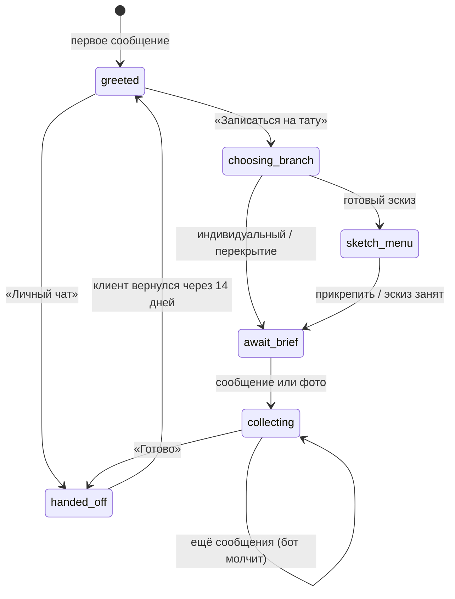
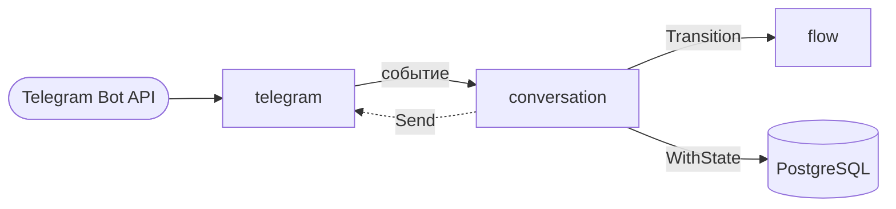

<div align="center">


# tattoosashbot

**Telegram-бот-консультант для тату-мастера, который отвечает клиентам из личного аккаунта**

[](https://go.dev)
[](https://www.postgresql.org)
[](deploy/Dockerfile)
[](https://core.telegram.org/bots/api#business-connection)

</div>

Мастер получает много однотипных сообщений: «сколько стоит?», «а этот эскиз свободен?», «можно перекрыть старую тату?». Бот подключается к её личному аккаунту через **Telegram Business** и сам встречает новых собеседников. Он проводит клиента по короткому брифу, собирает фото и пожелания, а потом передаёт диалог мастеру и замолкает.

Для клиента это обычная переписка с мастером: сообщения приходят от её имени, а не от отдельного бота.

## Возможности

- **Меню для каждого нового собеседника:** «Личный чат» или «Записаться на тату».
- **Три сценария записи:** готовый эскиз (свободный или уже занятый), индивидуальный эскиз, перекрытие или коррекция чужой работы.
- **Сбор материалов без спама:** на альбом из нескольких фото бот отвечает один раз и ждёт кнопку «Готово».
- **Передача диалога:** как только мастер пишет сама, бот перестаёт вмешиваться в этот чат.
- **Возврат клиента:** если в чате 14 дней тишины, на следующее сообщение клиент снова получает меню.
- **Защита от чужих подключений:** бот работает только в аккаунте владельца, даже если его подключит кто-то другой.
- **Оформление мастера:** HTML-ссылки на прайс и навигацию, кастомные эмодзи.

## Как устроен диалог



Сообщение мастера из любого состояния сразу переводит чат в `handed_off`. На схеме однотипные состояния объединены: в коде у каждого сценария свои `await_*` и `collecting_*`, чтобы отправить подходящий текст.

## Архитектура



| Пакет | Ответственность |
|---|---|
| `internal/flow` | Чистый конечный автомат `Transition(State, Event) (State, []Action)` и тексты. Не знает ни о Telegram, ни о базе. |
| `internal/conversation` | Сервис: читает состояние чата, вызывает автомат, отправляет ответы, сохраняет результат. Решает, вернулся ли клиент. |
| `internal/telegram` | Business-апдейты, кнопки, отправка от имени владельца, middleware. |
| `internal/storage/postgres` | Пул pgx, миграции goose, репозиторий на squirrel. |
| `cmd/bot` | Сборка зависимостей и корректная остановка. |

Зависимости идут в одну сторону, интерфейсы `StateRepo` и `Sender` объявлены в пакете, который их использует.

## Технические решения

<details>
<summary><b>Последовательная обработка одного чата</b></summary>

Клиент может отправить альбом из пяти фото, и пять обработчиков стартуют одновременно. Без синхронизации каждый прочитает одно и то же состояние и ответит. Поэтому репозиторий принимает колбэк и выполняет его внутри транзакции с блокировкой строки:

```sql
BEGIN;
INSERT ... ON CONFLICT (connection_id, chat_id) DO NOTHING;  -- строка точно существует
SELECT state, updated_at ... FOR UPDATE;                     -- остальные обработчики ждут
-- fn(current) -> next
UPDATE ...;
COMMIT;
```

Если отправка ответа не удалась, колбэк возвращает ошибку, транзакция откатывается, и состояние не меняется.
</details>

<details>
<summary><b>Особенности Telegram Business</b></summary>

- Ответ бота приходит обратно как `business_message` от имени владельца. Такое эхо отсекается по `sender_business_bot`, иначе бот принял бы собственный ответ за сообщение мастера.
- Сообщение владельца определяется по `from.id`, после него бот уходит в `handed_off`.
- Владелец подключения проверяется через `getBusinessConnection`, результат кэшируется в `sync.Map`.
- Reply-клавиатуры в Business-режиме не поддерживаются, поэтому только inline-кнопки. После нажатия клавиатура убирается.
</details>

<details>
<summary><b>Корректная остановка</b></summary>

По умолчанию `go-telegram/bot` запускает каждый обработчик в отдельной горутине и не ждёт их при остановке. Бот работает с `WithNotAsyncHandlers()` и четырьмя воркерами. Middleware `withTimeout` использует `context.WithoutCancel`, поэтому уже начатый ответ дорабатывает после SIGTERM, но не дольше 10 секунд. Ещё одна middleware перехватывает панику в обработчике.
</details>

<details>
<summary><b>Тесты</b></summary>

- `flow`: табличный тест на каждое правило автомата.
- `conversation`: полный диалог, ошибка отправки, 20 параллельных сообщений одного чата, граница TTL возврата с подменой времени.
- `storage/postgres`: настоящий PostgreSQL в [testcontainers](https://golang.testcontainers.org), включая тест, который падает без `FOR UPDATE`.

Все тесты запускаются с `-race`.
</details>

## Стек

Go 1.27 · [go-telegram/bot](https://github.com/go-telegram/bot) · `log/slog` · [caarlos0/env](https://github.com/caarlos0/env) · PostgreSQL 17 · [pgx](https://github.com/jackc/pgx) · [squirrel](https://github.com/Masterminds/squirrel) · [goose](https://github.com/pressly/goose) · testcontainers-go · golangci-lint · Docker (distroless) · Docker Compose

## Запуск локально

Нужны Go 1.27+, Docker и бот от [@BotFather](https://t.me/BotFather) с включённым Business Mode, подключённый к аккаунту в «Настройки → Telegram для бизнеса → Чат-боты».

```bash
git clone https://github.com/swokeqq/tattoosashbot.git
cd tattoosashbot
cp .env.example .env   # заполнить BOT_TOKEN, OWNER_USER_ID и пароль базы
docker compose up -d postgres
make run
```

```bash
make test   # нужен запущенный Docker
make lint
```

### Переменные окружения

| Переменная | Обязательна | По умолчанию | Описание |
|---|---|---|---|
| `BOT_TOKEN` | да | | Токен от BotFather |
| `OWNER_USER_ID` | да | | Telegram ID владельца аккаунта |
| `DATABASE_URL` | да | | Строка подключения к PostgreSQL |
| `HANDOFF_TTL` | | `336h` | Сколько тишины нужно, чтобы клиент снова получил меню |
| `LOG_LEVEL` | | `info` | `debug`, `info`, `warn`, `error` |
| `POSTGRES_USER`, `POSTGRES_PASSWORD`, `POSTGRES_DB` | для compose | | Учётные данные контейнера PostgreSQL |
| `IMAGE_NAME` | | `tattoosash` | Имя образа бота |
| `IMAGE_TAG` | | `dev` | Версия образа бота |

## Деплой

Образ собирается в два этапа и весит около 24 МБ: статический бинарник в `distroless/static:nonroot` без shell и root-пользователя. Миграции вшиты в бинарник через `embed` и применяются при старте.

```bash
docker build -f deploy/Dockerfile -t tattoosash:v0.1.1 .
docker save tattoosash:v0.1.1 | gzip | ssh server 'gunzip | docker load'
scp docker-compose.yml deploy/backup.sh server:/opt/tattoosash/
ssh server 'cd /opt/tattoosash && docker compose up -d'
```

Бот работает на VPS с 1 ГБ ОЗУ:

- **Порты:** наружу не открыт ни один. Бот сам опрашивает Telegram, база доступна только в сети compose.
- **Контейнеры:** `read_only`, `cap_drop: ALL`, `no-new-privileges`, ротация логов, `stop_grace_period` для корректной остановки.
- **Бэкапы:** `deploy/backup.sh` делает ежедневный `pg_dump` и хранит копии 14 дней.

## Структура

```
cmd/bot/                 точка входа
internal/config/         конфигурация из окружения
internal/flow/           автомат состояний и тексты
internal/conversation/   сервис диалога
internal/telegram/       Business API, middleware, клавиатуры
internal/storage/postgres/  репозиторий и миграции
migrations/              SQL-миграции (embed)
deploy/                  Dockerfile, скрипт бэкапа
```

## Лицензия

[MIT](LICENSE)
